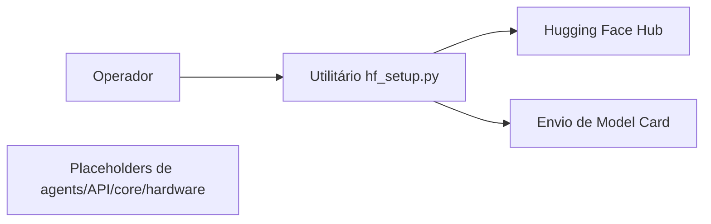

 |  | 

# EVA IA — Esqueleto de Publicação de Model Card

## Visão geral

O README apresenta EVA IA como projeto do Ecossistema Aurora voltado à soberania digital brasileira. Na árvore pública examinada, porém, o conteúdo executável visível limita-se a um utilitário Python para criar um repositório de modelo privado no Hugging Face e enviar um Model Card; os diretórios de agentes, API, núcleo e hardware contêm apenas arquivos placeholder. Não há implementação de modelo de IA visível.

## Objetivo e valor

**Problema/escopo:** Esqueleto Python da EVA IA com utilitário para publicar um Model Card em repositório privado no Hugging Face.

**Valor verificável hoje:** o repositório torna explícitos seus artefatos, interfaces e limitações para que mantenedores e contribuidores possam avaliar o que existe sem confundir demonstração, proposta e produção.

## Arquitetura e tecnologias

Não documentada e não demonstrada por implementação. A árvore tem agents/, api/, core/ e hardware_integration/, mas cada uma contém somente placeholder.py com comentários, sem módulos funcionais; não há workflows públicos na árvore recursiva examinada.

- Python (linguagem detectada pelo GitHub; arquivos .py na árvore).
- requirements.txt declara tensorflow, pytorch, fastapi e web3.py, sem versões fixadas; a presença dessas dependências não comprova integração ou uso funcional.
- hf_setup.py importa huggingface_hub; esse pacote não aparece em requirements.txt. O script declara uso da API Python do Hugging Face para criar repositório de modelo privado e enviar arquivo.

## Início rápido

Os comandos abaixo refletem instruções, manifestos ou pontos de entrada presentes no repositório. Dependências externas, segredos e serviços estão indicados quando aplicável; a presença de um comando não equivale a uma execução validada.

1. O README não documenta instalação ou execução. O único comando de execução diretamente inferível do script é `python hf_setup.py`; o bloco principal apenas imprime instruções e não chama setup_hf_repo nem inicia modelo ou serviço.
2. Ao executar esse script, o texto impresso recomenda `pip install huggingface_hub` e configurar token e ID do repositório no código. huggingface_hub não consta em requirements.txt.
3. requirements.txt lista quatro dependências, mas o repositório não fornece procedimento de instalação, versões, configuração ou comando de inicialização funcional; não há quickstart comprovado para o produto anunciado.

## Exemplo de uso

Interface concreta disponível em hf_setup.py: após instalar huggingface_hub e obter token de escrita do Hugging Face, um chamador pode usar `from hf_setup import setup_hf_repo; setup_hf_repo(repo_id="conta/EVA-IA", token="TOKEN_DE_ESCRITA")`. O código tenta criar um repositório de modelo privado e enviar HUGGINGFACE_README.md como README.md. É exemplo baseado na função definida, não uma execução verificada; o script principal não a invoca.

## Estado e limitações

**Maturidade indicada:** Experimental.

- As alegações do README sobre processamento local, operação offline, segurança cibernética e proteção de dados não são comprovadas pelo código visível.
- O Model Card anuncia capacidades multimodais, armazenamento em cristal 5D, sensores olfativos e blockchain DREX/TON, mas nenhum componente correspondente aparece implementado na árvore examinada.
- A função de setup depende de huggingface_hub ausente do manifesto e requer credencial de escrita; não guardar token em código ou compartilhá-lo.
- A listagem de TensorFlow, PyTorch, FastAPI e web3.py no manifesto, por si só, não comprova modelo, API ou integração blockchain funcionando.

## Contribuição

Leia [CONTRIBUTING.md](CONTRIBUTING.md) antes de abrir uma issue ou pull request. Para reportes de segurança, siga a orientação específica do repositório, se houver.

## Licença

Este repositório está licenciado sob **MIT**; consulte [LICENSE](LICENSE).

## Patrocínio e apoio

O desenvolvimento aberto exige tempo para manutenção, documentação, testes, revisão de contribuições e resposta a issues. Se este projeto for útil, considere apoiar a continuidade pelo [GitHub Sponsors](https://github.com/sponsors/felipetjmg1-bit). O apoio não representa promessa de funcionalidades, prazo de entrega ou suporte comercial.

